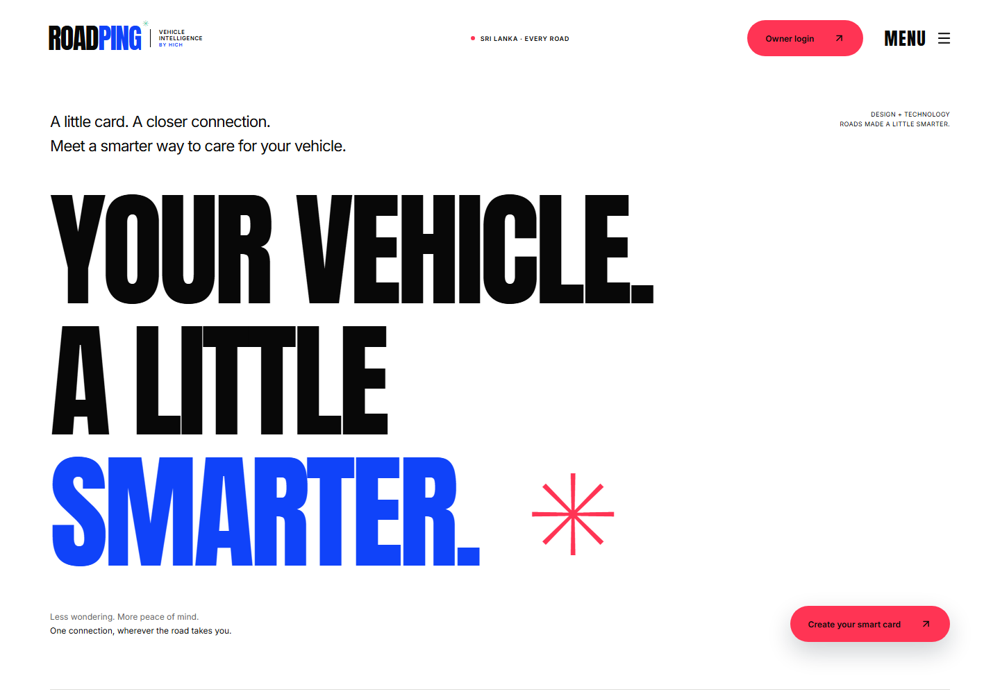
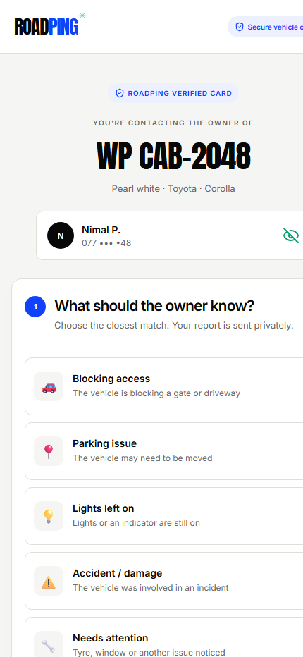
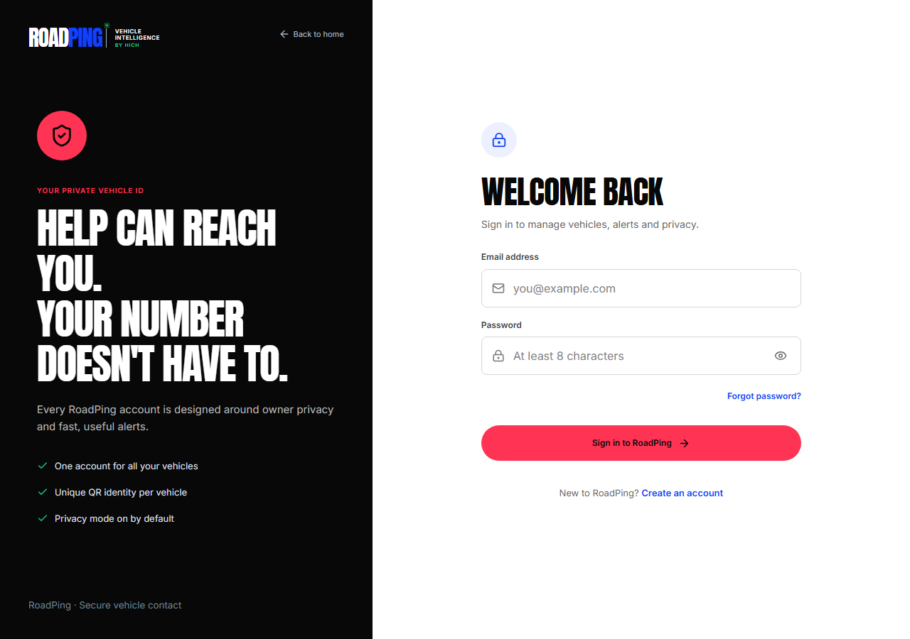
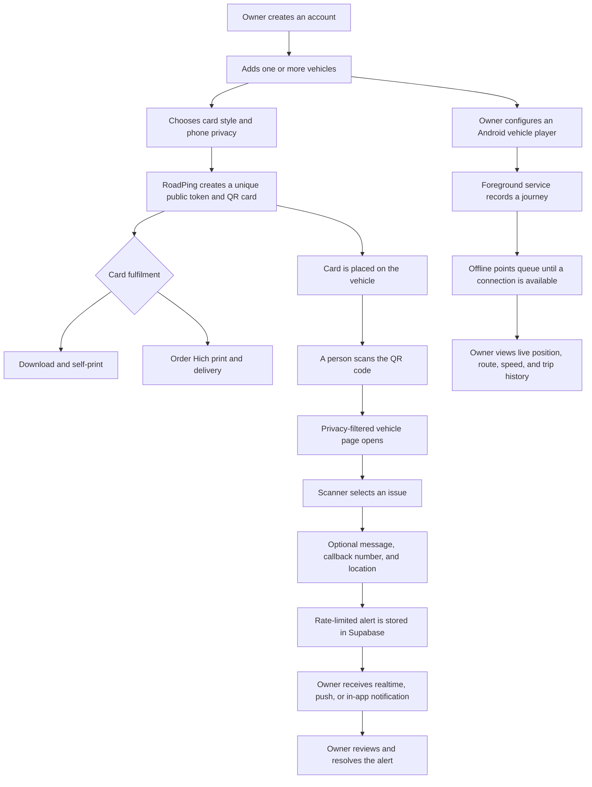

# RoadPing vehicle smart card

**A privacy-first vehicle identity, incident contact, card printing, and journey tracking system by Hich Web.**

RoadPing gives every vehicle a unique QR smart card. A person who notices blocked access, lights left on, damage, or another problem can scan the card and privately alert the owner without requiring the owner's phone number to be displayed. The owner manages multiple vehicles, cards, alerts, privacy settings, print orders, live location, and trip history from one account.

[Open the live RoadPing experience](https://roadping-vehicle-card.hiirantha.chatgpt.site) · [Try the public card demo](https://roadping-vehicle-card.hiirantha.chatgpt.site/#/v/demo-roadping)

## Why RoadPing matters

- **It protects the owner's privacy.** Phone visibility is controlled by the owner and defaults to hidden. A scanner can still send a useful alert without seeing the full number.
- **It shortens the time between a problem and a response.** Structured alert types, an optional message, callback number, and current location give the owner useful context immediately.
- **It connects vehicle identity and vehicle activity.** The same vehicle record powers its QR card, public contact page, print choice, tracker, live position, and journey history.
- **It works through real-world interruptions.** The Android player stores location points in an offline SQLite queue and uploads them when connectivity returns. Tracking can recover after a reboot.
- **It limits unnecessary exposure.** Public access goes through privacy-filtered, rate-limited database functions. Owner records, raw contacts, alerts, print orders, tracker devices, trips, and GPS points remain protected by Row Level Security.

## System screenshots

### RoadPing experience



| Public vehicle scan | Secure owner portal |
| --- | --- |
| A scanner identifies the vehicle and chooses a private alert type. | The owner signs in to manage vehicles, alerts, cards, privacy, and tracking. |
|  |  |

## How the system flows



### Owner flow

1. Create an account and set owner, emergency contact, social link, and phone privacy details.
2. Add a vehicle with its registration number, type, make, model, colour, year, nickname, and card theme.
3. Preview the generated smart card, download a high-resolution PNG, or order a printed card for **LKR 1,990**.
4. Use the dashboard to manage vehicles, see incoming reports, change alert status, and control whether a card is active.
5. Sign the same native Android app into a phone or compatible full-Android head unit, configure Vehicle Player Mode, and choose the tracked vehicle.
6. Review the vehicle's latest position and completed journeys from the web or Android owner interface.

### Scanner flow

1. Scan the QR code without installing an app or creating an account.
2. Confirm the registration number and limited vehicle details.
3. Choose the closest issue: blocking access, parking issue, lights left on, accident or damage, vehicle attention, or another message.
4. Optionally add details, a callback number, and the scanner's current location.
5. Send the report privately. The owner's protected data remains behind the authenticated application.

### Tracking flow

1. Vehicle Player Mode starts a tracking session through an authenticated Supabase RPC.
2. A visible Android location foreground service records GPS position, speed, accuracy, battery, and network information.
3. Points are written to a local SQLite queue first, so a weak or missing connection does not discard the journey.
4. Batched points update the live tracker and trip totals when the connection is available.
5. A normal stop, device restart, or server-side stale-session maintenance closes the trip cleanly.
6. Only the vehicle owner can view the resulting route and journey history.

## Main capabilities

| Area | Capabilities |
| --- | --- |
| Vehicle identity | One owner to many vehicles, unique random public token, QR card, four visual themes, pause/resume control |
| Private contact | Hidden, masked, or visible phone mode; structured alerts; optional message, contact, and location |
| Owner experience | Responsive dashboard, PWA installation, vehicle management, alert inbox, realtime updates, profile and privacy controls |
| Card fulfilment | High-resolution PNG download, self-print option, or Hich print-order and delivery workflow |
| Android | Native Java app, Owner Mode, Vehicle Player Mode, on-device QR generation, notifications, foreground tracking, boot recovery |
| Journey intelligence | Live location, route map, distance, duration, maximum speed, point count, and trip history |
| Backend | Supabase Auth, Postgres, Row Level Security, RPC validation, Realtime, Edge Functions, web push, and maintenance jobs |

## Architecture

| Project | Technology | Responsibility |
| --- | --- | --- |
| `web/` | React, TypeScript, Vite, Supabase JS, Leaflet | Marketing site, installable PWA, owner portal, public QR page, printing, alerts, and maps |
| `android-app/` | Native Java, Android SDK 35, SQLite, ZXing | Owner interface, QR generation, notification polling, and reliable vehicle-player tracking |
| `supabase/` | PostgreSQL, RLS, SQL RPCs, Realtime, Edge Functions | Authentication, protected data, public alert boundary, print orders, tracking sessions, push, and maintenance |

## Security and privacy model

- Every vehicle receives a random UUID public token; sequential database IDs are never used in QR URLs.
- Anonymous users can call only the privacy-filtered vehicle profile function and the rate-limited alert submission function.
- Row Level Security scopes vehicles, alerts, orders, tracker devices, sessions, and location points to their owner.
- Scanner location and callback details are optional and are delivered only to the owner.
- Client applications use a Supabase publishable key. Service-role secrets belong only in protected server or Edge Function configuration.
- A previously shared service key must be rotated in the Supabase dashboard before production deployment.

## Project structure

```text
.
├── web/          React + TypeScript website and installable PWA
├── android-app/  Native Java Android application
├── supabase/     Database migrations, seed guidance, and Edge Functions
└── docs/         Project screenshots used in this README
```

## Local setup

### 1. Configure Supabase

Install the Supabase CLI, link the project, and apply both migrations:

```powershell
supabase link --project-ref avixsqfvfonlioslhxif
supabase db push
```

Then follow [`supabase/README.md`](supabase/README.md) to configure email authentication, password recovery, web push, the incident webhook, and stale-tracker maintenance.

### 2. Run the web application

```powershell
cd web
Copy-Item .env.example .env.local
npm install
npm run dev
```

Set these values in `web/.env.local`:

```dotenv
VITE_SUPABASE_URL=https://your-project.supabase.co
VITE_SUPABASE_PUBLISHABLE_KEY=your-publishable-key
VITE_PUBLIC_APP_URL=https://your-site.example
VITE_VAPID_PUBLIC_KEY=your-vapid-public-key
```

Build the production bundle with `npm run build`.

### 3. Build the Android application

Requirements: Java 17, Android SDK 35, and an Android SDK path in `android-app/local.properties`.

Review the Supabase URL, publishable key, and public application URL in `android-app/app/build.gradle.kts`, then run:

```powershell
cd android-app
.\gradlew.bat assembleDebug
```

The APK is generated at `android-app/app/build/outputs/apk/debug/app-debug.apk`. The downloadable copy served by the website is `web/public/downloads/roadping.apk`.

## Production checklist

- Rotate the previously exposed Supabase service key and keep all service-role values outside client applications.
- Configure production SMTP, allowed redirect URLs, VAPID credentials, Edge Function secrets, and the database webhook.
- Schedule `tracking-maintenance` once per minute so trips close after a vehicle player loses power or connectivity.
- Create and back up a release signing key before distributing a production APK.
- Publish a privacy policy and complete the required Google Play background-location review.
- Vehicle Player Mode supports full Android head units. Projected Android Auto requires a separate implementation using Google's approved templates.
